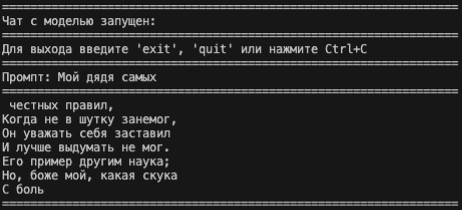

# LittleLM



### Описание проекта:

Это мой первый опыт разработки и обучения языковой модели, в данном проекте я стараюсь одновременно с изучением концепций пройти путь от простой модели предсказывающей следующий смысл до моделей, которые понимают смысл промптов и дают осознанный ответ, при этом не используя большие вычислительные мощности.

### Цель проекта:

Обучить модель на произведениях А.С. Пушкина с применением `fine-tuning`, чтобы на обычные пользовательские запросы мы получали ответ в стилистике произведений русского классика.

### Состояние проекта:

1. Разработана первая версия модели — `Base_Model`, в котором реализована маленькая нейросеть, которая предсказывает слeдующий символ. На данный момент она прекрасно повторяет уже изученный текст, но как только в промпте попадает то, чего в произведении нет, модель отвечает бессмыслицу с выдуманными словами, но при этом сохраняет структуру произведения, на котором она обучалась.

2. Разработана вторая версия модели — `Base_Model_V2`, которая повторяет первую версию, но написана уже через инструменты **PyTorch**, так как это упростит дальнейшие эксперименты и улучшения модели.

3. В процессе разработки третья версия модели, где цель достигнуть более осмысленных ответов от модели и чтобы модель заканчивала мысль, а не обрывала свой ответ, как достигается установленная длина ответа.

### Идеи по улучшению модели:

- **`Токенизация`** — отказаться от предсказания отдельных символов и перейти на `3-граммы`;

- **`Механизм внимания`** — для расширения и более глубокого понимания контекста моделью необходимо внедрить данный механизм;
- **`Уведичения данных обучения`** — сейчас модель обучена на одном произведении **"Онегин"**, для более разнообразных ответов было решено добавить для обучени модели еще 2-3 произведения автора;
- **`Добавление валидационных данных`** — данный шаг позволит более точно оценивать качество модели, сейчас мы только наблюдаем, когда модель заучила обучающие данные, но о обобщающей способности мы ничего сказать не можем;
- **`Данные для Fine-Tuning`** — добавление небольшого датасета с примерами ожидаемых ответов для модели, чтобы у нее были примеры ответов на промпты, которые не связаны с произведениями.

### Быстрый старт:

```bash
>>>cd project
>>>uv sync
>>>uv run python -m little_lm
```

>Для обучения или загрузки модели с другими параметрами используете следующую команду (предварительно создав папку с эти названием и конфигом для нее):

```bash
>>>uv run python -m little_lm --model_name <Название модели>
```

### Применяемые технологии в проекте:

- **NumPy**
- **PyTorch**
- **Polars**
- **Matplotlib**